# empleados para resolver incidencias

## tabla original de incidencias de entrega
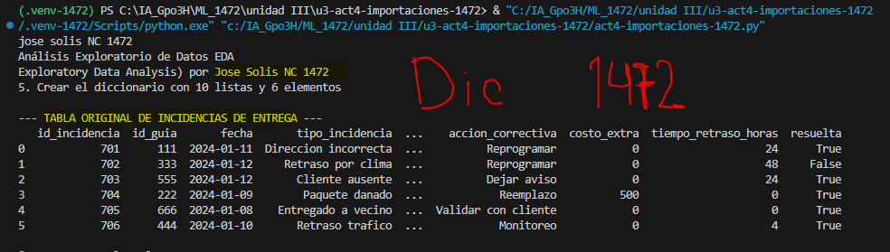

## 7. Convertir el DataFrame en archivo CSV
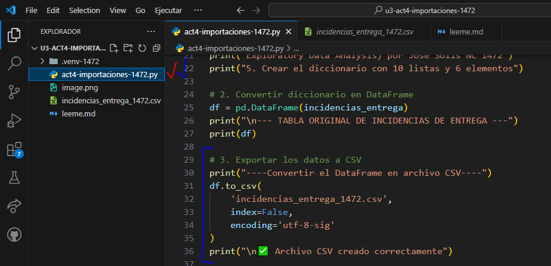

## datos en csv --> base de datos
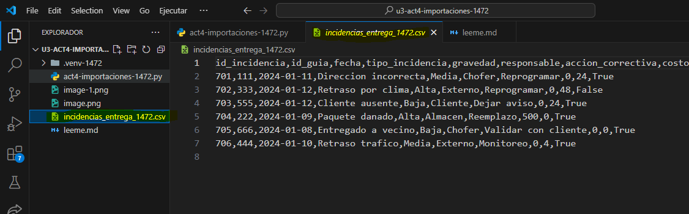

## 8. Leer los datos desde el archivo CSV
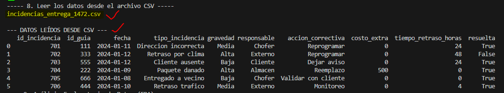

## 9. Análisis Exploratorio de Datos (EDA)
### primeros y ultimos registros
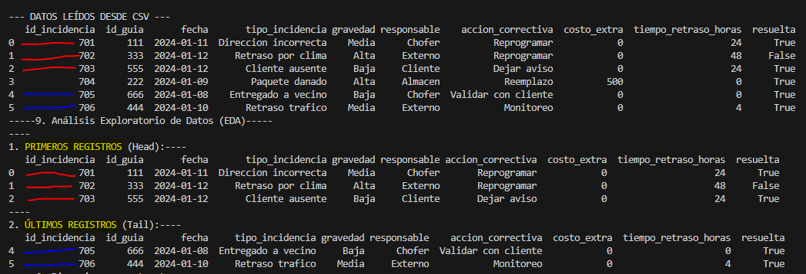

## 6. Dimensiones y estructura
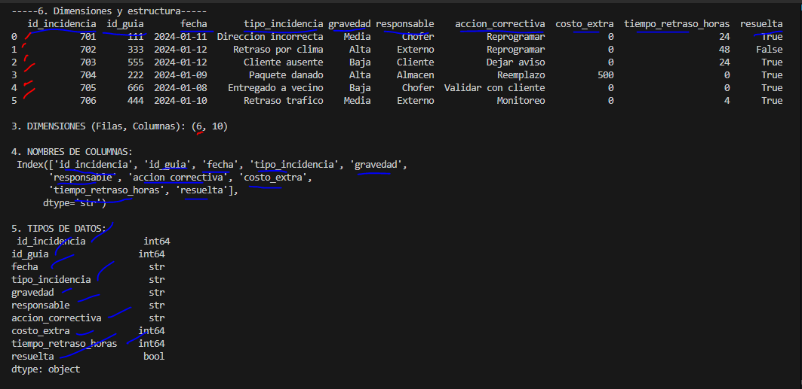

## 7. Estadísticas y limpieza
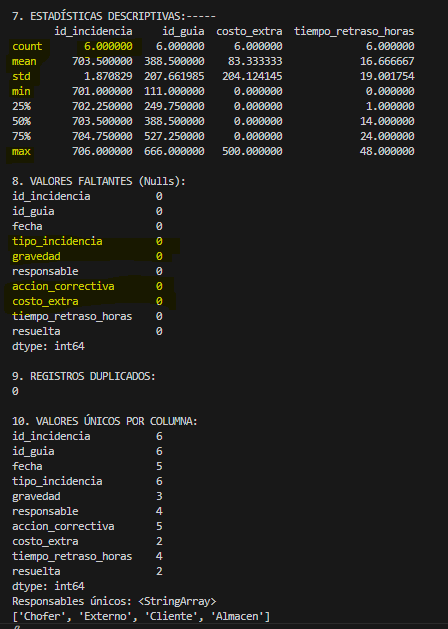

## 8 y 9. Ordenamiento, filtrado y agrupación
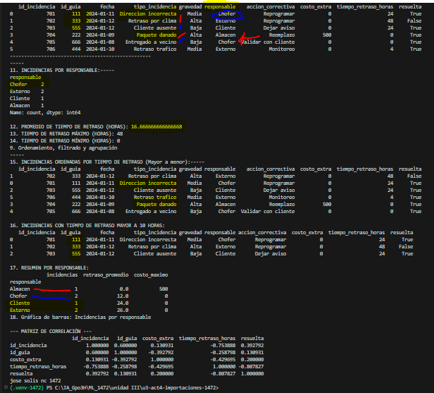

## 18. Gráfica de barras: Incidencias por responsable
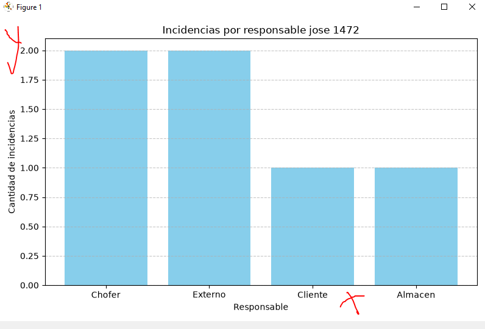
## 19. Gráfica de barras: Tiempo de retraso por tipo de incidencia
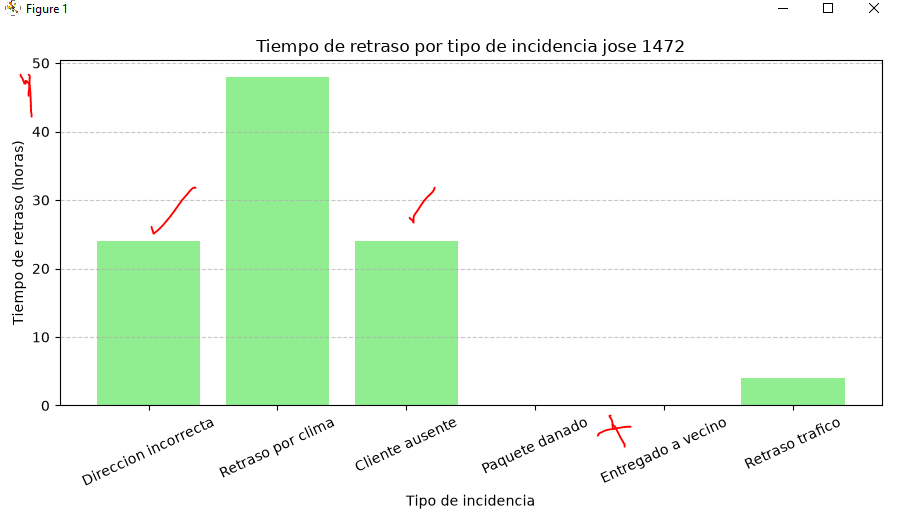
## 20. Histograma: Distribución de tiempo de retraso
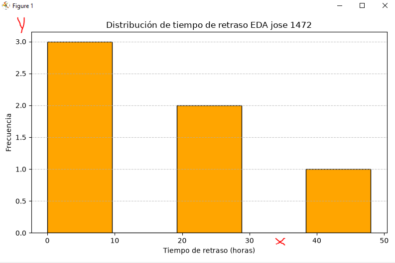
## 21. Gráfica de dispersión: Tiempo de retraso vs Costo extra
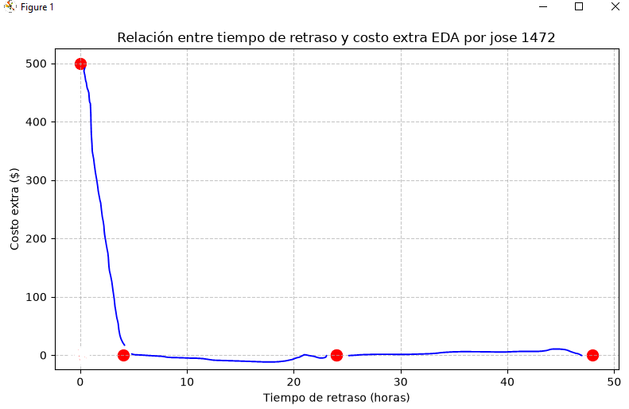
## 22. Diagrama de caja: Distribución de tiempo de retraso
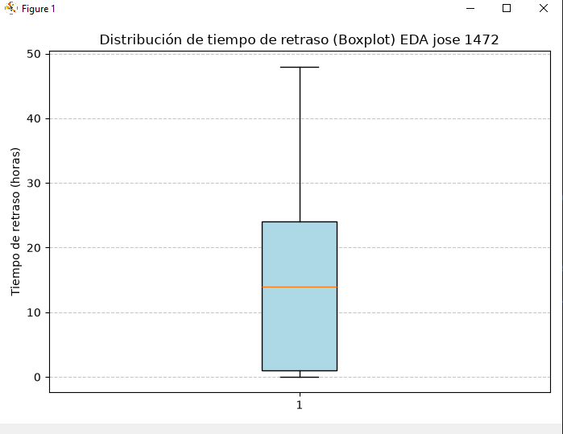
## 23. Matriz de correlación de variables numéricas
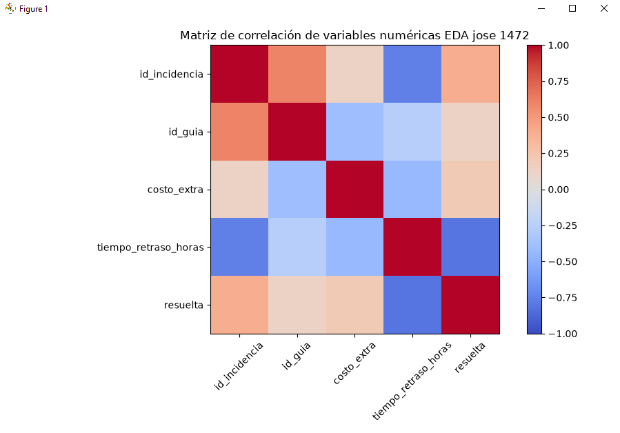

